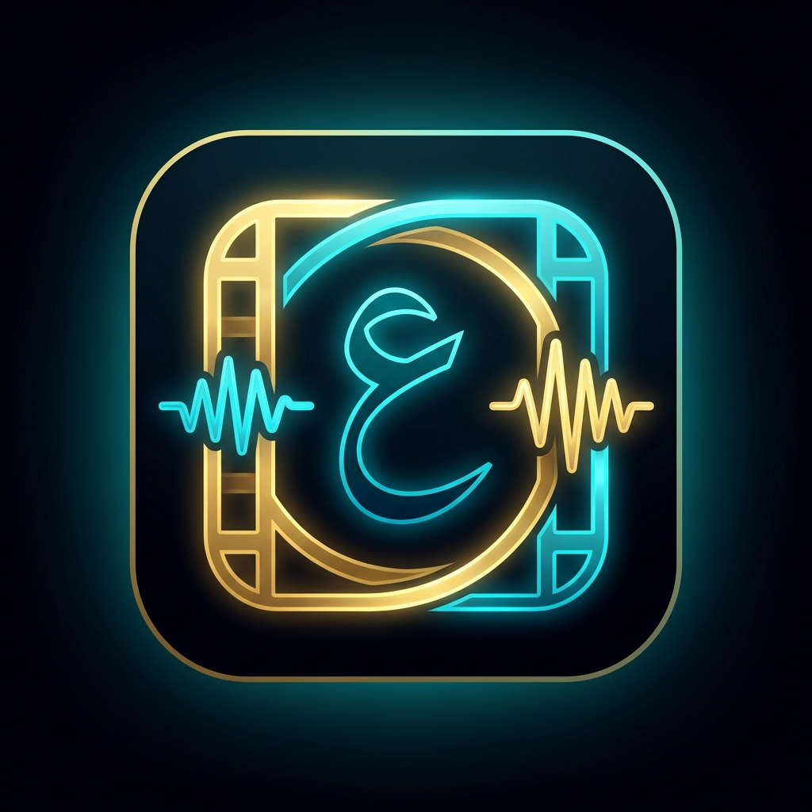

# Arabic Subs (عربي سبس) 🎬

<p align="center">
  
</p>

<p align="center">
  <strong>Point it at your movies. It writes the Arabic subtitles.</strong><br>
  Fully offline EN→AR subtitles on Android — the engine runs <em>inside the app</em>.
  No cloud, no account, no tracking, no Termux.
</p>

<p align="center">
  <a href="https://github.com/muxd22-alt/arabic_subtitles/releases/latest"></a>
  
  
  <a href="LICENSE"></a>
</p>

---

## The whole thing, on your phone

Arabic Subs is a self-contained Android app. The whole engine — a Node runtime,
`llama-server` (Hy-MT2 translation), `whisper.cpp` (speech), and `ffmpeg`/
`ffprobe` — is bundled **inside the APK** as `arm64-v8a` native libraries and
unpacked on first run. It runs as a child process of the app, in a foreground
service. **There is no Termux, no server, no cloud, and nothing to compile on
your phone.**

## How to use

| | Step | What you do |
| :--: | :--- | :--- |
| **1** | **Install** | Install the [latest APK](https://github.com/muxd22-alt/arabic_subtitles/releases/latest). It is sideloaded — there is no Play Store listing. |
| **2** | **Grant & pick** | Allow **all-files access**, then tap **«إضافة مجلد أفلام / مسلسلات»** and pick your Movies / TV folder (e.g. `/sdcard/Movies`). |
| **3** | **Download the models** | Tap **نزّل النموذج**. This also installs/repairs the bundled engine, then downloads the translation + speech models **once** into `<your folder>/ArabicSubs/models/` (~1.2 GB, resumable). |
| **4** | **Run** | Tap **تشغيل الكل** to work through the whole queue, or **▶ ترجمة** on one row to translate a single file. |

The first launch walks you through steps 1–3 with a short wizard. On later runs
you only touch the dashboard. A **تنظيف وفحص** button clears skipped items and
re-checks the sidecars already on disk.

<details>
<summary>What if something goes wrong</summary>

- **`killed by signal SIGSEGV`** → the engine crashed. Reopen the app so it
  re-unpacks the bundled engine. Details:
  `<media>/ArabicSubs/models/llama-server.log`.
- **`tensor 'blk.0.attn_k_norm.weight' has offset …, expected …`** → the model and
  the engine disagree on the quant format. Delete `<media>/ArabicSubs/models/` and
  run again so both are fetched as a matched pair.
- **Nothing happens when you tap run** → make sure all-files access is granted and
  at least one media folder is chosen (the wizard walks through both).

</details>

## What it produces

For every video it writes a single sidecar next to the video:

```text
Movie.ArabicSubs.ar.ass
```

- **ASS/SSA v4.00+**, not SRT. The style is `Default`, and the typeface is
  **`Thmanyah Sans`** (`src/ass.js`).
- The first cue is always the watermark: `[ ترجمة الأداة عربي سبس ]`
  (shown from 1s to 4s).
- Because the subtitle asks for **Thmanyah Sans**, your **video player must have
  that font installed** for the Arabic to render as intended. The font files are
  in this repo under [`docs/fonts/`](docs/fonts/) (regular and bold OTFs) —
  install the OTF on the device that plays the video (e.g. via your player's
  font/MX Player font setting).
- Existing `.ArabicSubs.ar.srt` files from before 2.4 are still recognised as
  "done", so upgrading never re-translates a library you already have.

## Features

| Feature | What it does |
| :--- | :--- |
| **On-device translation** | Tencent **Hy-MT2-1.8B** (Q4_K_M GGUF, ~1.06 GB) served by `llama-server`. |
| **Speech transcription** | `whisper.cpp` (`base`) for videos with no subtitle track. |
| **Smart source picking** | Existing subtitle → use it; English subtitle → translate; embedded track → extract then translate; otherwise transcribe the audio. |
| **Queue or single file** | **تشغيل الكل** runs the library one film at a time; **▶ ترجمة** does just one. |
| **Skip / unskip + reclean** | Exclude a video, then **تنظيف وفحص** to reset and re-scan. |
| **Live status** | The dashboard observes the foreground service for the active stage and progress. |
| **100% offline after setup** | The only network use is the one-time model download. |

## Command-line engine

The same engine also runs as a Node CLI — on a desktop, a NAS, or anywhere
Node 18+ is installed. This is separate from the APK and still fully supported:

```bash
node bin/arabic-subs.js setup                              # download the models
node bin/arabic-subs.js run --media /path/to/Movies        # the queue
node bin/arabic-subs.js process "/path/to/Movies/Gladiator.mkv"  # one film
node bin/arabic-subs.js translate movie.srt --out movie.ar.ass   # one subtitle file
node bin/arabic-subs.js transcribe movie.mkv --out movie.srt     # audio → English SRT
node bin/arabic-subs.js scan /path/to/Movies               # what would happen
node bin/arabic-subs.js status                             # engine/model status
```

## How it decides

For every video, in this order — and it logs every decision to
`logs/decisions.jsonl`:

| # | If… | Then | Model |
| :--: | :--- | :--- | :--- |
| 1 | the Arabic subtitle already exists | skip (idempotent) | — |
| 2 | an Arabic subtitle sits next to the video | brand it and save | — |
| 3 | an English subtitle sits next to the video | translate the cues | loaded |
| 4 | the video has an embedded subtitle track | extract, then translate | loaded |
| 5 | no subtitles, but there is audio | transcribe with whisper, then translate | loaded |
| 6 | neither | skip, with the reason logged | — |

The app works on one video at a time so the phone stays cool; inside a video,
cues are batched and translated in parallel.

## What runs on your phone

| Piece | What it is |
| :--- | :--- |
| **Translation** | Tencent **Hy-MT2-1.8B**, Q4_K_M GGUF. ~1.06 GB, served by `llama-server`. |
| **Transcription** | `whisper.cpp` (`base`), only for videos with no subtitle track. |
| **Engine** | Node + `llama-server` + `whisper-cli` + `ffmpeg`/`ffprobe`, prebuilt for android-arm64 — bundled **inside** the APK |

The engine is **prebuilt, not compiled on the phone**: cross-compiled with the
Android NDK, statically linked (needs only `libc`/`libm`/`libdl`), 16 KB-page
ready for Android 15+, and baseline NEON so it runs on any arm64 device. It ships
inside the APK and is unpacked on first run. See
[`docs/engine-binaries.md`](docs/engine-binaries.md) for provenance and hashes.

> **Why Q4_K_M and not the tiny 1.25-bit model?**<br>
> Hy-MT2 also ships extreme-bit GGUFs — 1.25-bit "Sherry" (STQ1_0) and 2-bit
> "Stride16" (int2). Both are **gated behind unmerged llama.cpp PRs**
> ([#22836](https://github.com/ggml-org/llama.cpp/pull/22836) and draft
> [#19357](https://github.com/ggml-org/llama.cpp/pull/19357)), so no ordinary
> llama.cpp can read them — they abort with
> `tensor 'blk.0.attn_k_norm.weight' has offset …, expected …`. Q4_K_M is an
> ordinary quant, so the engine stops depending on a pinned fork commit, at the
> cost of 1.06 GB instead of 440 MB. Want more accuracy? Set
> `HYMT_MODEL_FLAVOR=q8_0` (1.9 GB) or `=q6_k` (1.5 GB) — both from Tencent's
> official repo. The 1.25-bit file is still selectable with
> `HYMT_MODEL_FLAVOR=stq`, but it needs the fork engine.

## Configuration

Set these as environment variables (or in a `.env` file) for the CLI engine:

| Variable | Default | Meaning |
| :--- | :--- | :--- |
| `HYMT_MODEL_FLAVOR` | `q4_k_m` | model to use: `q4_k_m`, `q6_k`, `q8_0` (standard) or `stq` (1.25-bit, fork engine) |
| `HYMT2_MODEL` | `~/.arabic-subs/models/Hy-MT2-1.8B-Q4_K_M.gguf` | model path |
| `LLAMA_PORT` | `18434` | engine port |
| `TRANSLATE_CONCURRENCY` | `4` | parallel cue workers |
| `TRANSLATE_BATCH_LINES` | `16` | cues per request |
| `WHISPER_MODEL` | `base` | `tiny` / `base` / `small` |
| `LLAMA_SERVER_BIN` | auto | use your own `llama-server` |

## Requirements

- **Android 9 (API 28) or newer**, **arm64-v8a** device for the APK.
- **Node 18+** for the command-line engine.
- ~1.2 GB free space for the models (in `<media>/ArabicSubs/models/` for the app,
  or `~/.arabic-subs/models/` for the CLI). Delete the folder to reclaim it; it
  re-downloads next run.

## Build from source

**Android app** — needs JDK 17 and the Android SDK (API 35, Build Tools 35.0.0):

```bash
./gradlew assembleDebug     # app/build/outputs/apk/debug/app-debug.apk
./gradlew assembleRelease   # app/build/outputs/apk/release/app-release.apk
```

The `syncNodeSources` Gradle task copies `bin/` + `src/` + `package.json` into
`app/src/main/assets/node/` before every build, so the app always carries the
current engine sources.

**Engine / CLI** — needs Node 18+:

```bash
npm test                    # 87 tests, fully offline
node scripts/verify-engine-libs.mjs   # check the bundled arm64 libraries
```

Layout: `bin/arabic-subs.js` (CLI), `src/` (engine, media, pipeline),
`app/` (Android app + bundled engine).

## License

MIT — see [LICENSE](LICENSE). The bundled third-party tools keep their own
licenses; see [`docs/engine-binaries.md`](docs/engine-binaries.md).
